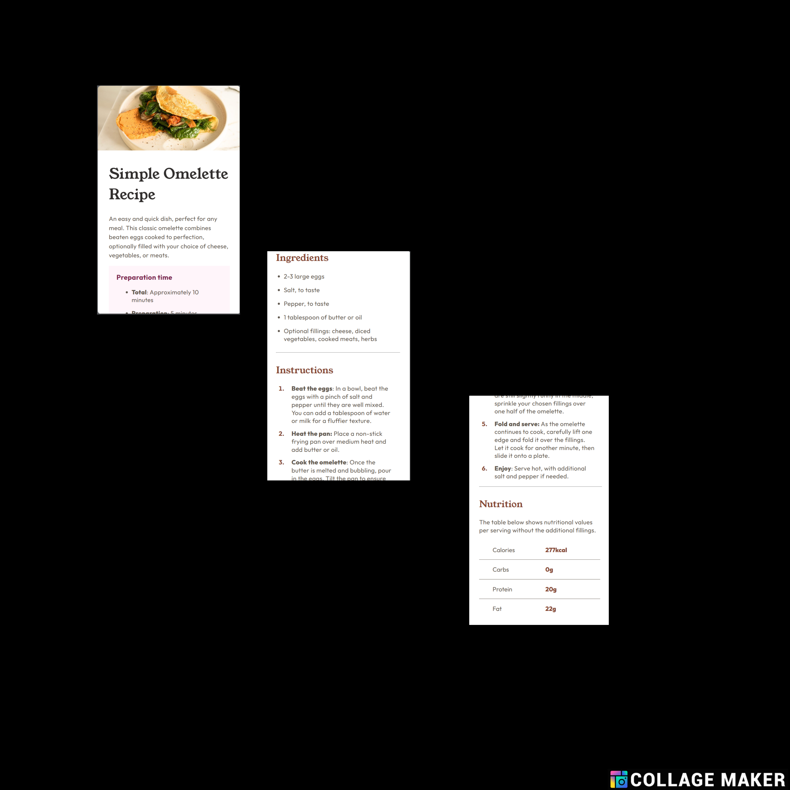
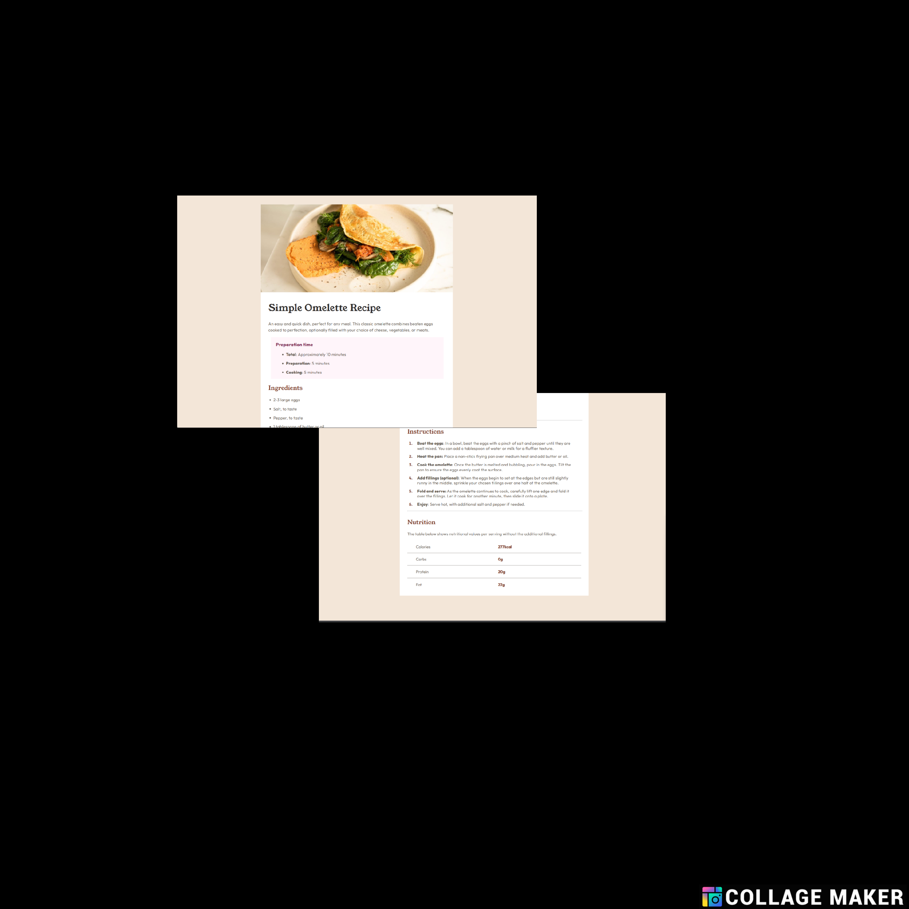

# Frontend Mentor - Recipe page solution

This is a solution to the [Recipe page challenge on Frontend Mentor](https://www.frontendmentor.io/challenges/recipe-page-KiTsR8QQKm). Frontend Mentor challenges help you improve your coding skills by building realistic projects. 

## Table of contents

- [Overview](#overview)
  - [The challenge](#the-challenge)
  - [Screenshot](#screenshot)
  - [Links](#links)
- [My process](#my-process)
  - [Built with](#built-with)
  - [What I learned](#what-i-learned)
  - [Continued development](#continued-development)
- [Author](#author)

## Overview

### Screenshot

### Links

- Solution URL: [Solution URL](https://github.com/kateemillerhd/recipe_page)
- Live Site URL: [Live site URL](https://kateemillerhd.github.io/recipe_page)

## My process

### Built with

- Semantic HTML5 markup
- CSS custom properties
- Flexbox
- Mobile-first workflow

### What I learned

Continuing to learn about spatial relationships and how the "cascade" affects elements down the line.

### Continued development

I will continue to develop my understanding of how elements relate to each other in CSS and widen my knowledge on different ways to achieve results I am looking for.
-

## Author

- Frontend Mentor - [@kateemillerhd](https://www.frontendmentor.io/profile/kateemillerhd)
